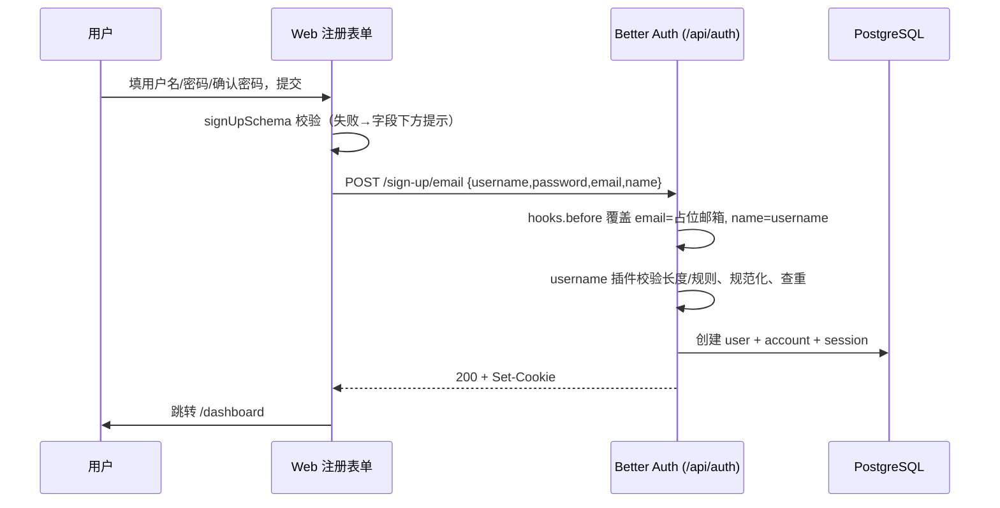

# 用户名账号（注册 / 登录） - 设计

> 对应需求：[requirements.md](./requirements.md)

## 概述

启用 Better Auth 自带的 `username` 插件（已在 `better-auth@1.7.12` 内，不是新依赖）。注册仍走 `POST /api/auth/sign-up/email`，由服务端 `hooks.before` 按用户名生成占位邮箱并覆盖请求体里的 email / name，所以客户端传什么邮箱都无效；登录走插件提供的 `POST /api/auth/sign-in/username`，同时用 `disabledPaths` 关掉邮箱登录。用户名、密码校验规则和中文提示语放在 `packages/auth/src/credentials.ts`（只依赖 zod），服务端、Web、Native 三处共用同一份规则。

同时在本 feature 第一个任务里搭好测试基础设施（Vitest + Playwright，W2 已确认引入），供 02、03 复用。

## 技术背景

> 依据：[AGENTS.md](../../../AGENTS.md)、[apps/web/AGENTS.md](../../../apps/web/AGENTS.md)

| 项 | 本 feature 遵循的约定 | 出处 |
|----|----------------------|------|
| 技术栈 | Better Auth 1.7.12（`username` 插件）、Prisma 7、Next.js 16、TanStack Form、Zod v4、sonner | AGENTS.md § 技术栈 |
| 目录与分层 | 鉴权配置在 `packages/auth`（工厂函数，不读环境变量）；schema 由 `pnpm auth:generate` 生成 `auth.prisma`，不手改；Web 组件在 `apps/web/src/components` | AGENTS.md § 架构要点、目录结构 |
| 命名 | 内部包源码直连，导入形如 `@sl-ai-admin/auth/credentials` | AGENTS.md § 源码直连 |
| 接口约定 | 鉴权接口挂在 server `/api/auth/*`，由 Better Auth 处理；错误以 Better Auth 错误码返回 | AGENTS.md § 鉴权流程 |
| 数据库 | 改 schema 后 `pnpm db:generate`，再 `pnpm db:migrate`（W2 确认用迁移） | AGENTS.md § 数据库 |
| 代码规范 | Ultracite / Biome：`pnpm check`；类型 `pnpm check-types` | AGENTS.md § 常用命令、Ultracite |
| 测试与验证 | 项目原本无测试框架；本 feature 引入 Vitest（单元）、Playwright（Web E2E） | W2 确认 |

参考的现有实现：

- `packages/auth/src/index.ts`：`createAuth` 工厂，在此加插件、hooks、disabledPaths。
- `apps/web/src/components/sign-in-form.tsx`、`sign-up-form.tsx`：TanStack Form + zod 校验 + sonner toast 的写法，改造为用户名表单。
- `apps/web/src/lib/auth-client.ts`：加 `usernameClient()` 插件。

## 涉及范围

| 类型 | 路径 / 模块 | 新增 / 修改 | 说明 |
|------|-------------|-------------|------|
| 测试 | `packages/auth/vitest.config.ts`、`packages/auth/package.json`（`test` 脚本） | 新增 / 修改 | Vitest |
| 测试 | `apps/web/playwright.config.ts`、`apps/web/e2e/`、`apps/web/package.json`（`test:e2e`） | 新增 / 修改 | Playwright，`webServer` 启动 server + web |
| 配置 | 根 `package.json`（`test`、`test:e2e`）、`turbo.json`（`test` 任务）、`pnpm-workspace.yaml`（catalog 加 vitest、@playwright/test）、`.gitignore` | 修改 | |
| 共享规则 | `packages/auth/src/credentials.ts` | 新增 | 校验 schema、占位邮箱、错误码 → 中文提示 |
| 后端 | `packages/auth/src/index.ts` | 修改 | `username` 插件、`hooks.before`、`disabledPaths` |
| 数据库 | `packages/db/prisma/schema/auth.prisma` | 修改（生成） | `pnpm auth:generate` 产出 |
| 数据库 | `packages/db/prisma/migrations/<时间戳>_init_username_auth/` | 新增 | `pnpm db:migrate` 产出（项目首个迁移） |
| 前端 | `apps/web/src/lib/auth-client.ts` | 修改 | `usernameClient()` |
| 前端 | `apps/web/src/components/sign-in-form.tsx` | 修改 | 用户名登录 |
| 前端 | `apps/web/src/components/sign-up-form.tsx` | 修改 | 用户名 + 确认密码 |
| 前端 | `apps/web/src/app/login/page.tsx` | 修改 | 默认显示登录表单（`useState(true)`） |
| 前端 | `apps/web/package.json` | 修改 | 加 `@sl-ai-admin/auth: workspace:*` |

## 数据模型

满足 R1。由 `username` 插件新增到 `user` 表（`pnpm auth:generate` 生成，不手改）：

| 字段 | 类型 | 约束 | 说明 |
|------|------|------|------|
| username | String? | unique | 规范化（小写）后的用户名，登录用 |
| displayUsername | String? | | 用户注册时的原始写法，界面显示用 |

现有字段的用法：`email` 存占位邮箱 `<小写用户名>@users.sl-ai-admin.local`（unique 约束天然再挡一次重复）；`name` 存原始用户名。

## 接口设计

均由 Better Auth 提供，不新增 tRPC 接口。

### `POST /api/auth/sign-up/email`（满足 R1–R4）

- 请求：`{ username, password, email, name }`。`email`、`name` 由客户端用 `toPlaceholderEmail(username)` / `username` 填，但服务端 `hooks.before` 会强制覆盖。
- 响应：成功返回 `{ token, user }` 并 Set-Cookie（`autoSignIn` 默认开启，满足 R3）。
- 错误码：`USERNAME_IS_ALREADY_TAKEN`、`USER_ALREADY_EXISTS*`（→「用户名已被注册」）；`INVALID_USERNAME`、`USERNAME_TOO_SHORT`、`USERNAME_TOO_LONG`（→「用户名格式不正确」）；`PASSWORD_TOO_SHORT`（→「密码至少 8 位」）。

### `POST /api/auth/sign-in/username`（满足 R5、R6）

- 请求：`{ username, password }`
- 错误码：`INVALID_USERNAME_OR_PASSWORD` 等 → 前端一律「用户名或密码错误」。

### `POST /api/auth/sign-in/email`

- 通过 `disabledPaths: ["/sign-in/email"]` 关闭，返回 404（满足 R1 安全要求）。

### 服务端配置（`packages/auth/src/index.ts`）

```ts
plugins: [
  expo(),
  username({
    minUsernameLength: USERNAME_MIN_LENGTH, // 3
    maxUsernameLength: USERNAME_MAX_LENGTH, // 20
    usernameValidator: (value) => USERNAME_PATTERN.test(value),
    // usernameNormalization 用默认（转小写），displayUsername 保留原始写法
  }),
],
disabledPaths: ["/sign-in/email"],
hooks: {
  before: createAuthMiddleware(async (ctx) => {
    if (ctx.path !== "/sign-up/email") return;
    const name = String(ctx.body?.username ?? "");
    return { context: { body: { ...ctx.body, name, email: toPlaceholderEmail(name) } } };
  }),
},
```

### 共享模块 `packages/auth/src/credentials.ts`

只导入 zod，供 server / web / native 共用：

- 常量：`USERNAME_MIN_LENGTH = 3`、`USERNAME_MAX_LENGTH = 20`、`USERNAME_PATTERN = /^[A-Za-z0-9_]+$/`、`PASSWORD_MIN_LENGTH = 8`、`PLACEHOLDER_EMAIL_DOMAIN = "users.sl-ai-admin.local"`
- `AUTH_MESSAGES`：所有中文提示语
- `signInSchema`、`signUpSchema`（含 `confirmPassword` 的 `refine`，错误挂在 `confirmPassword` 路径）
- `toPlaceholderEmail(username)`：`${username.toLowerCase()}@${PLACEHOLDER_EMAIL_DOMAIN}`
- `getSignUpErrorMessage(code?: string)`、`getSignInErrorMessage(status?: number)`：错误码 / 状态码 → 中文提示

## 前端设计

满足 R2、R5–R8。

- `login/page.tsx`：仍为客户端组件，`useState(true)` 默认登录表单（02 会把它改成服务端判断登录态的结构）。
- `sign-in-form.tsx`：字段 `username`、`password`，`validators.onSubmit = signInSchema`；调用 `authClient.signIn.username`；`onError` → `toast.error(getSignInErrorMessage(status))`；成功 `router.push("/dashboard")`。
- `sign-up-form.tsx`：字段 `username`、`password`、`confirmPassword`，`validators.onSubmit = signUpSchema`；调用 `authClient.signUp.email({ username, password, name: username, email: toPlaceholderEmail(username) })`；`onError` → `toast.error(getSignUpErrorMessage(code))`；成功 `router.push("/dashboard")`。
- 校验错误沿用现有写法渲染在对应 `form.Field` 下方；按钮沿用 `form.Subscribe` 的 `isSubmitting` 禁用 + 加载文案（R7）。
- 文案全部中文。

## 关键流程

满足 R1、R3。



## 异常与边界情况

| 场景 | 处理方式 |
|------|----------|
| 绕过前端直接传非法用户名 | 插件 `usernameValidator` / 长度校验拒绝 |
| 仅大小写不同的重复用户名 | 默认规范化为小写后查重 → `USERNAME_IS_ALREADY_TAKEN` |
| 客户端伪造 email 字段 | `hooks.before` 强制覆盖为占位邮箱 |
| 尝试用占位邮箱登录 | `/sign-in/email` 已禁用 |
| 网络错误 / 5xx | 登录提示「登录失败，请稍后重试」，注册提示「注册失败，请稍后重试」 |

## 测试策略

- **Vitest**（`packages/auth/src/credentials.test.ts`）：用户名边界（2/3/20/21 位、非法字符、下划线）、密码 7/8 位、确认密码不一致、`toPlaceholderEmail` 小写化、错误码映射。
- **Playwright**（`apps/web/e2e/auth.spec.ts`）：注册成功跳转、表单校验提示、重复用户名（含大小写）、登录成功、登录失败统一提示、默认登录表单；`request` 夹具验证 `/sign-in/email` 返回 404、非法用户名注册被拒。每个用例用随机用户名，避免依赖数据清理。
- 前置条件：本地 PostgreSQL 运行在 5432（W2 已通过 Homebrew 安装并启动）。

## 待确认问题

- 无。
