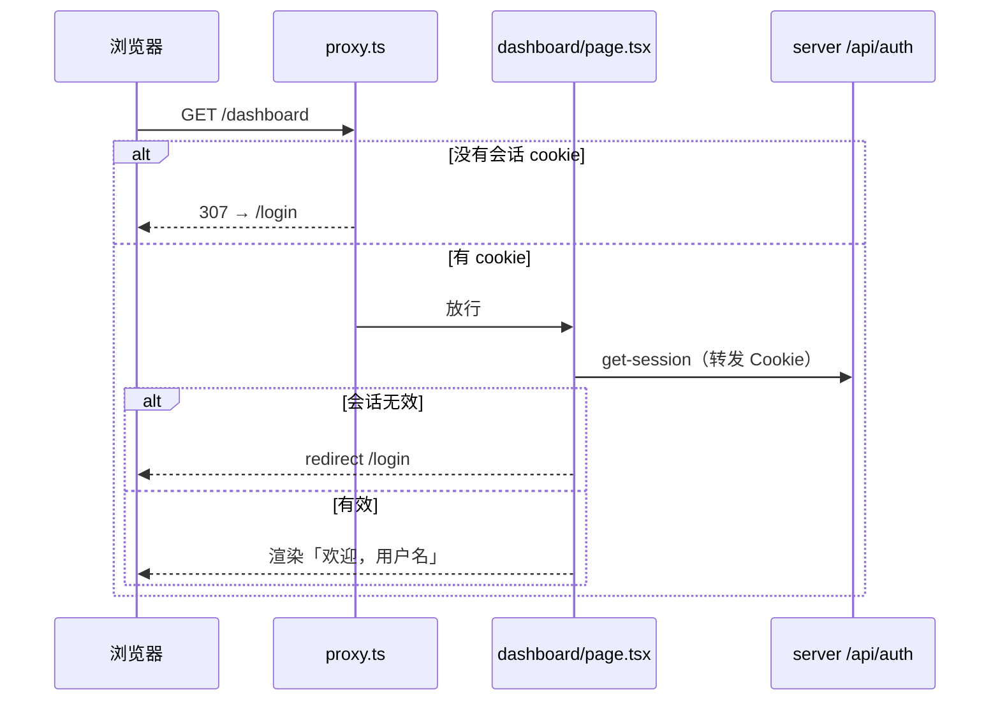

# Web 访问控制与退出登录 - 设计

> 对应需求：[requirements.md](./requirements.md)

## 概述

分两层：`src/proxy.ts`（Next.js 16 中 Middleware 改名为 Proxy）只根据有没有会话 cookie 做「乐观」跳转，减少无谓渲染；真正的判断放在服务端页面里，用 `getServerSession()` 向 server 校验会话，然后 `redirect()`。Next 官方文档（`node_modules/next/dist/docs/01-app/01-getting-started/16-proxy.md`）明确说 Proxy 不应作为完整的鉴权方案，所以页面里的判断必须保留。登录页拆成服务端 `page.tsx`（判断已登录就跳走）和客户端 `auth-forms.tsx`（表单切换）。

## 技术背景

> 依据：[AGENTS.md](../../../AGENTS.md)、[apps/web/AGENTS.md](../../../apps/web/AGENTS.md)

| 项 | 本 feature 遵循的约定 | 出处 |
|----|----------------------|------|
| 技术栈 | Next.js 16 App Router（Proxy、Server Components、`redirect`）、Better Auth react 客户端、shadcn DropdownMenu | AGENTS.md § 技术栈；apps/web/AGENTS.md |
| 目录与分层 | Web 路由在 `apps/web/src/app`，组件在 `apps/web/src/components`，工具在 `apps/web/src/lib` | AGENTS.md § 目录结构 |
| 鉴权 | Better Auth 挂在 server `/api/auth/*`，Web 用跨域 Cookie（`credentials: "include"`） | AGENTS.md § 鉴权流程 |
| 接口约定 | 需要登录的 tRPC 接口用 `protectedProcedure`，无会话抛 `UNAUTHORIZED` | AGENTS.md § 端到端类型安全 |
| 代码规范 | Ultracite / Biome；Next.js 用 Server Components 取数 | AGENTS.md § Framework-Specific Guidance |
| 测试与验证 | Playwright（01 已搭建）：`pnpm test:e2e` | 01 design.md § 测试策略 |

参考的现有实现：

- `apps/web/src/app/dashboard/page.tsx`：已有用 `authClient.getSession({ fetchOptions: { headers: await headers() } })` 在服务端取会话再 `redirect` 的写法，抽成公共函数复用。
- `apps/web/src/components/user-menu.tsx`：现有下拉菜单，改文案与退出跳转。
- `packages/api/src/index.ts`：`protectedProcedure` 已实现 401。

## 涉及范围

| 类型 | 路径 / 模块 | 新增 / 修改 | 说明 |
|------|-------------|-------------|------|
| 前端 | `apps/web/src/lib/get-server-session.ts` | 新增 | 服务端取会话（转发请求头） |
| 前端 | `apps/web/src/proxy.ts` | 新增 | 乐观跳转，matcher：`/dashboard/:path*`、`/login` |
| 前端 | `apps/web/src/app/dashboard/page.tsx` | 修改 | 用 `getServerSession`；显示「欢迎，<用户名>」 |
| 前端 | `apps/web/src/app/dashboard/dashboard.tsx` | 修改 | 文案中文化；去掉对邮箱的展示（如有） |
| 前端 | `apps/web/src/app/login/page.tsx` | 修改 | 改为服务端组件：已登录 `redirect("/dashboard")` |
| 前端 | `apps/web/src/app/login/auth-forms.tsx` | 新增 | 客户端组件：登录 / 注册表单切换（从原 page.tsx 移入，默认登录） |
| 前端 | `apps/web/src/components/user-menu.tsx` | 修改 | 显示用户名、「退出登录」→ `/login`、未登录「登录」 |
| 前端 | `apps/web/src/components/header.tsx` | 修改 | 导航文案中文化（首页 / 后台） |
| 测试 | `apps/web/e2e/access-control.spec.ts` | 新增 | AC1–AC6 |

## 接口设计

不新增接口。满足 R5 的现有行为：

### `GET /trpc/privateData`

- 无会话：`protectedProcedure` 抛 `TRPCError({ code: "UNAUTHORIZED" })`，`@hono/trpc-server` 映射为 HTTP 401。
- 有会话：200，返回 `{ message, user }`。

## 前端设计

满足 R1–R4。

- **`getServerSession()`**（`lib/get-server-session.ts`）：`authClient.getSession({ fetchOptions: { headers: await headers() } })`，返回 `session | null`（不 `throw`，网络错误按未登录处理并跳转登录页）。
- **`proxy.ts`**：用 `getSessionCookie(request)`（`better-auth/cookies`）判断有无会话 cookie。访问 `/dashboard*` 且没有 cookie → 重定向 `/login`；`/login` 不在 Proxy 里跳转（cookie 可能已过期，交给页面判断）。
- **`dashboard/page.tsx`**：`const session = await getServerSession(); if (!session) redirect("/login");` 显示 `欢迎，{displayUsername ?? username}`。
- **`login/page.tsx`**（服务端）：`if (session) redirect("/dashboard"); return <AuthForms />`。
- **`user-menu.tsx`**：触发按钮显示用户名；菜单项「退出登录」调用 `authClient.signOut()`，`onSuccess` 里 `useQueryClient().clear()`（TanStack Query）、`router.replace("/login")`、`router.refresh()`。
- 用户名显示规则统一写成 `apps/web/src/lib/display-name.ts` 里的 `getDisplayName(user)`，dashboard 和菜单共用。

## 关键流程

满足 R1、R3。

## 异常与边界情况

| 场景 | 处理方式 |
|------|----------|
| cookie 存在但会话过期 | Proxy 放行，页面 `getServerSession` 为空 → `redirect("/login")`；`/login` 正常显示 |
| server 不可达 | `getServerSession` 返回 null → 后台页跳登录页 |
| 退出后浏览器后退 | `router.refresh()` + 服务端判断，后退到 `/dashboard` 会重新校验并跳回 `/login` |
| 生产环境 web 与 server 不同域名 | 会话 cookie 在 server 域名下，Proxy 读不到 → 本期本地开发同为 localhost 可用；跨域部署方案不在本期范围，记录在 AGENTS.md 经验中 |

## 测试策略

- **Playwright**（`apps/web/e2e/access-control.spec.ts`）：AC1–AC5 走浏览器；AC6 用 `request` 夹具直接请求 `http://localhost:3000/trpc/privateData`（先不带 cookie，再用注册接口拿到 cookie 后请求）。
- 复用 01 的注册辅助函数（抽到 `apps/web/e2e/helpers.ts`）生成随机用户。

## 待确认问题

- 无。
