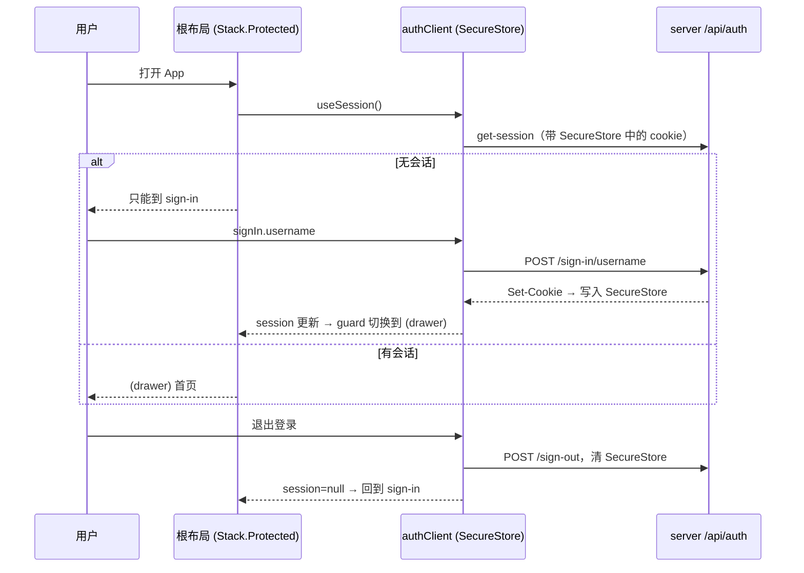

# 移动端用户名登录注册 - 设计

> 对应需求：[requirements.md](./requirements.md)

## 概述

用 Expo Router 的 `Stack.Protected` 在根布局按会话状态切换可访问的路由组：有会话时暴露 `(drawer)` 和 `modal`，无会话时只暴露新增的 `sign-in` 页面。这样登录态一变，路由会自动切换，深链接也绕不过去。表单组件复用现有 `components/sign-in.tsx`、`sign-up.tsx` 的 HeroUI Native + TanStack Form 写法，改成用户名字段，校验规则和提示语从 `@sl-ai-admin/auth/credentials` 引入，和 Web 共用。认证客户端加 `usernameClient()`。

## 技术背景

> 依据：[AGENTS.md](../../../AGENTS.md)

| 项 | 本 feature 遵循的约定 | 出处 |
|----|----------------------|------|
| 技术栈 | Expo SDK 58 + Expo Router（`Stack.Protected`）、HeroUI Native、Uniwind、TanStack Form、Zod v4 | AGENTS.md § 技术栈 |
| 目录与分层 | 路由在 `apps/native/app`，组件在 `apps/native/components`，认证客户端在 `apps/native/lib/auth-client.ts` | AGENTS.md § 目录结构 |
| 鉴权 | Better Auth Expo 插件，会话存 SecureStore；tRPC 请求通过 `authClient.getCookie()` 带 Cookie | AGENTS.md § 鉴权流程 |
| UI | Native 用 HeroUI Native + Uniwind，不用 `packages/ui` | AGENTS.md § UI |
| 内部包 | 源码直连，`@sl-ai-admin/auth/credentials` 指向 `src/credentials.ts` | AGENTS.md § 源码直连 |
| 测试与验证 | `pnpm -F native check-types`；打包检查 `pnpm -F native exec expo export --platform ios`；模拟器手动验收 | W2 确认 |

参考的现有实现：

- `apps/native/components/sign-in.tsx`、`sign-up.tsx`：HeroUI `TextField` / `FieldError` / `Spinner` + `useToast` + TanStack Form 的写法。
- `apps/native/app/(drawer)/index.tsx`：现有首页卡片与退出按钮写法。
- `apps/native/app/(drawer)/_layout.tsx`：`headerRight` 放 `ThemeToggle` 的写法，用户菜单照此放。

## 涉及范围

| 类型 | 路径 / 模块 | 新增 / 修改 | 说明 |
|------|-------------|-------------|------|
| 依赖 | `apps/native/package.json` | 修改 | 加 `@sl-ai-admin/auth: workspace:*`（内部包，不是外部依赖） |
| 认证 | `apps/native/lib/auth-client.ts` | 修改 | 加 `usernameClient()` |
| 路由 | `apps/native/app/_layout.tsx` | 修改 | `useSession` + `Stack.Protected`；加载中显示 Spinner |
| 路由 | `apps/native/app/sign-in.tsx` | 新增 | 登录 / 注册切换页（默认登录） |
| 组件 | `apps/native/components/sign-in.tsx` | 修改 | 用户名登录、统一错误提示、加载状态、中文 |
| 组件 | `apps/native/components/sign-up.tsx` | 修改 | 用户名 + 确认密码、错误码映射、中文 |
| 组件 | `apps/native/components/user-menu.tsx` | 新增 | 页头右侧：用户名 + 「退出登录」 |
| 路由 | `apps/native/app/(drawer)/_layout.tsx` | 修改 | `headerRight` 放 `ThemeToggle` + `UserMenu` |
| 路由 | `apps/native/app/(drawer)/index.tsx` | 修改 | 去掉登录/注册卡片和邮箱，显示「欢迎，<用户名>」 |
| 工具 | `apps/native/lib/display-name.ts` | 新增 | `getDisplayName(user)`（与 Web 同规则） |

## 接口设计

不新增接口，使用 01 已启用的 Better Auth 接口：`POST /api/auth/sign-up/email`、`POST /api/auth/sign-in/username`、`POST /api/auth/sign-out`。

## 前端设计

满足 R1–R7。

**根布局 `app/_layout.tsx`**

```tsx
const { data: session, isPending } = authClient.useSession();
if (isPending) return <全屏 Spinner />;
<Stack>
  <Stack.Protected guard={Boolean(session)}>
    <Stack.Screen name="(drawer)" options={{ headerShown: false }} />
    <Stack.Screen name="modal" options={{ title: "Modal", presentation: "modal" }} />
  </Stack.Protected>
  <Stack.Protected guard={!session}>
    <Stack.Screen name="sign-in" options={{ headerShown: false }} />
  </Stack.Protected>
</Stack>
```

**`app/sign-in.tsx`**：`useState(true)` 控制显示 `<SignIn onSwitch />` 或 `<SignUp onSwitch />`，外层用现有 `Container`。

**`components/sign-in.tsx`**：字段 `username`、`password`；`validators.onSubmit = signInSchema`；`authClient.signIn.username`；`onError` → `toast.show({ variant: "danger", label: getSignInErrorMessage(status) })`；成功后 `queryClient.invalidateQueries()`（路由由 guard 自动切换）。提交中 `Button isDisabled` + `Spinner`。

**`components/sign-up.tsx`**：字段 `username`、`password`、`confirmPassword`；`signUpSchema`；`authClient.signUp.email({ username, password, name: username, email: toPlaceholderEmail(username) })`；`onError` → `getSignUpErrorMessage(code)`。

**`components/user-menu.tsx`**：显示用户名文本 + 「退出登录」按钮；点击 `await authClient.signOut()`，然后 `queryClient.clear()`；guard 自动回到 `sign-in`。

## 关键流程

满足 R5、R6。



## 异常与边界情况

| 场景 | 处理方式 |
|------|----------|
| 启动时会话加载中 | 全屏 Spinner，不渲染路由，避免闪现登录页 |
| 未登录用深链接打开受保护页 | `Stack.Protected` 拦截，落到 `sign-in` |
| 服务器不可达 | `useSession` 返回空 → 显示登录页；提交时 toast「登录失败，请稍后重试」 |
| Metro 解析不到 `@sl-ai-admin/auth/credentials` | 以 `expo export` 打包检查暴露；Expo SDK 58 默认支持 monorepo，若失败在 `metro.config.js` 调整 `watchFolders` 并写入 AGENTS.md 经验 |
| 原 `components/sign-in.tsx` 里的通用 `getErrorMessage` | 保留，用于把 TanStack Form 的字段错误转为字符串 |

## 测试策略

- 共享校验规则已在 01 的 Vitest 用例覆盖。
- 自动化：`pnpm -F native check-types`、改动文件 ultracite 检查、`expo export --platform ios` 打包成功。
- 手动（W8 交付时由用户在模拟器完成）：AC1–AC8，交付报告里附检查清单。

## 待确认问题

- 无。

## 实现偏差

- 根布局加载态：原设计 `if (isPending) return <Spinner />` → 实际只在**首次**会话加载完成前显示 Spinner（`hasLoadedSession` 状态），之后不再卸载导航 → 原因：Better Auth 在会话为空时每次重新拉取（登录 / 注册成功后、App 回到前台）都会把 `isPending` 设回 `true`，按原设计会在提交中卸载登录表单、丢失输入。
- 根布局去掉 `unstable_settings.anchor = "(drawer)"` → 原因：未登录时 `(drawer)` 被 `Stack.Protected` 排除，再把它作为锚点压到历史栈底部会和守卫跳转互相干扰；`modal` 只从 Tabs 页头进入，不需要锚点。
- 表单网络异常：原设计只在 `onError` 里提示 → 实际在 `signIn.username` / `signUp.email` 外再包一层 `try/catch`，toast `AUTH_MESSAGES.signInFailed` / `signUpFailed` → 原因：服务器不可达时 better-fetch 直接抛异常，不会调用 `onError`，否则 R4「登录失败，请稍后重试」不会出现。
- 退出登录：`authClient.signOut()` 失败时忽略错误，照常 `queryClient.clear()` → 原因：Expo 插件在发请求**之前**就清空 SecureStore 会话并把 session 置空，本地已退出；服务端会话到期自然失效。
- `getErrorMessage`：原设计保留在 `components/sign-in.tsx` → 实际移到 `apps/native/lib/form-error.ts`，登录 / 注册两个表单共用（原来两个文件各有一份）。
- `UserMenu` 同时放到 Tabs 页头 → 原因：`(tabs)` 屏自己覆盖了 `headerRight`（「+」打开 Modal），不加的话 Tabs 页没有退出入口。
- `biome.json`：`noJsxPropsBind` 的关闭范围从 `apps/web/**` 扩到 `apps/native/**` → 原因：同 01 的理由，Native 也开了 React Compiler（`app.json` 的 `experiments.reactCompiler`）。
- `lib/auth-client.ts`：`import * as SecureStore` 改为具名导入并组装 `storage` 对象 → 原因：Ultracite `noNamespaceImport`。
- 首页的状态卡片文字（系统状态、在线 / 离线、连接状态）和抽屉「首页」改成中文 → 原因：非功能需求「界面文字使用中文」。
