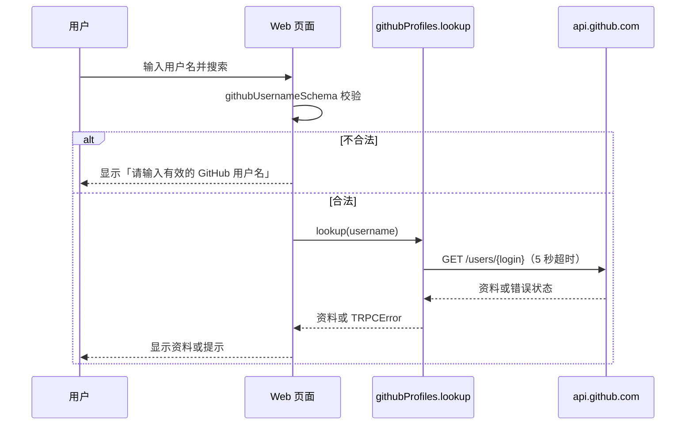

# GitHub 用户搜索（Web） - 设计

> 对应需求：[requirements.md](./requirements.md)

## 概述

沿用基线提交 21e11b3 中已有的 `githubProfiles.lookup` 接口和 `/dashboard/github-users` 页面（还没有测试）。本 feature 补齐两个与需求不符的地方，并加上测试：

1. 接口的 Zod 校验失败时，tRPC 把 issue 列表的 JSON 放进 `error.message`，页面会显示原始 JSON。改为提交前用共享规则校验，由前端显示中文提示。接口仍保留同一份校验。
2. `apps/web/src/utils/trpc.ts` 的全局 `QueryCache.onError` 会弹 toast，页面内又显示一次。改为这个页面的查询跳过全局 toast。

## 技术背景

> 依据：[AGENTS.md](../../../AGENTS.md)、[apps/web/AGENTS.md](../../../apps/web/AGENTS.md)

| 项 | 本 feature 遵循的约定 | 出处 |
|----|----------------------|------|
| 技术栈 | Next.js 16 App Router、tRPC v11 + TanStack Query、Zod v4、shadcn（base-ui） | AGENTS.md § 技术栈 |
| 目录与分层 | procedure 放 `packages/api/src/routers/`，后台页放 `/dashboard/*`，内部包按 `exports` 直连源码 | AGENTS.md § 架构要点 |
| 共享规则 | 规则只放一处、各端共用，只依赖 zod，参照 `packages/auth/src/credentials.ts` | AGENTS.md § 架构要点 |
| 接口约定 | 需要登录的用 `protectedProcedure`，前端只 `import type { AppRouter }` | AGENTS.md § 架构要点 |
| 登录拦截 | Proxy 只看 cookie，页面内仍调用 `getServerSession()` | AGENTS.md § 经验沉淀 |
| 导航链接 | 用 `<Link className={buttonVariants(...)}>`，不用 `Button render` | AGENTS.md § 经验沉淀 |
| 测试与验证 | Vitest（`src/**/*.test.ts`）、Playwright（`apps/web/e2e/`）、只检查改动文件的 ultracite | AGENTS.md § 常用命令、§ 经验沉淀 |

参考的现有实现：

- `packages/auth/src/credentials.ts`、`packages/auth/src/credentials.test.ts`：共享规则及其单元测试
- `packages/auth/vitest.config.ts`：Vitest 配置
- `apps/web/e2e/access-control.spec.ts`、`apps/web/e2e/helpers.ts`：页面访问控制和测试账号

## 涉及范围

| 类型 | 路径 / 模块 | 新增 / 修改 | 说明 |
|------|-------------|-------------|------|
| 共享规则 | `packages/api/src/github-profile-rules.ts` | 新增 | 用户名规则和提示语，只依赖 zod；导入路径 `@sl-ai-admin/api/github-profile-rules` |
| 后端 | `packages/api/src/routers/github-profiles.ts` | 修改 | 改用共享规则 |
| 后端 | `packages/api/src/routers/index.ts` | 修改 | 挂载 `githubProfiles`（已存在，核对） |
| 测试 | `packages/api/package.json`、`packages/api/vitest.config.ts` | 修改、新增 | 增加 `test` 脚本和 Vitest |
| 测试 | `packages/api/src/routers/github-profiles.test.ts`、`packages/api/src/github-profile-rules.test.ts` | 新增 | 错误映射和校验规则 |
| 前端 | `apps/web/src/app/dashboard/page.tsx` | 修改 | 入口链接（已存在，核对） |
| 前端 | `apps/web/src/app/dashboard/github-users/page.tsx` | 修改 | 页面和登录校验（已存在，核对） |
| 前端 | `apps/web/src/app/dashboard/github-users/github-users.tsx` | 修改 | 提交前校验，错误只显示一次 |
| 前端 | `apps/web/src/utils/trpc.ts` | 修改 | `QueryCache.onError` 支持按查询跳过 toast |
| 测试 | `apps/web/e2e/github-users.spec.ts` | 新增 | 页面访问控制、校验、搜索 |

## 接口设计

满足 R2、R3、R4、R5。

### `githubProfiles.lookup`（`protectedProcedure` query）

- 请求参数：`string`，共享规则 `githubUsernameSchema`
- 响应：`{ avatarUrl: string | null, bio: string | null, githubId: string, location: string | null, name: string | null, username: string }`
- 错误码：

| 条件 | tRPC code | message |
|------|-----------|---------|
| 未登录 | `UNAUTHORIZED` | Authentication required |
| GitHub 404 | `NOT_FOUND` | 找不到该 GitHub 用户 |
| GitHub 403 / 429 | `TOO_MANY_REQUESTS` | GitHub 查询暂时受限，请稍后重试 |
| 网络失败、超时（5 秒）、其他状态码、内容不合法 | `BAD_GATEWAY` | 暂时无法读取 GitHub 资料，请稍后重试 |

### 共享规则（`packages/api/src/github-profile-rules.ts`）

```ts
export const GITHUB_PROFILE_MESSAGES = {
	invalidUsername: "请输入有效的 GitHub 用户名",
} as const;

export const githubUsernameSchema = z
	.string()
	.trim()
	.max(39, GITHUB_PROFILE_MESSAGES.invalidUsername)
	.regex(/^[a-z\d]+(?:-[a-z\d]+)*$/i, GITHUB_PROFILE_MESSAGES.invalidUsername);
```

## 界面设计

满足 R1、R3、R4、R5、R6。

### Web · GitHub 用户管理页

- 组件结构：`page.tsx`（服务端，校验会话）→ `GithubUsers`（客户端）→ 搜索卡片 + `ProfileDetails`
- 状态：`search`（已提交的用户名）、`formatError`（提交前校验错误）；`lookup` 为 `useQuery`，`enabled: search.length > 0`，`retry: false`
- 提交流程：`githubUsernameSchema.safeParse(value)` 失败时设置 `formatError` 且不改 `search`；成功时清空 `formatError` 再查询；用户名不变时调用 `refetch`
- 跳过全局 toast：`QueryCache.onError` 判断 `query.meta?.skipErrorToast`，`lookup` 传 `meta: { skipErrorToast: true }`
- 状态显示：加载 `正在搜索…`（`role="status"`）；错误 `role="alert"`；查询中按钮禁用

## 关键流程

满足 R3、R4、R5。



## 异常与边界情况

| 场景 | 处理方式 |
|------|----------|
| 只输入空格 | trim 后为空，正则不通过，显示格式提示 |
| 输入大小写与 GitHub 不同 | 使用 GitHub 返回的 `login` 显示 |
| 头像不是 GitHub 头像域名 | `avatarUrl` 返回 `null`，不显示头像 |
| 绕过前端直接调用接口且用户名不合法 | 接口返回 400 |

## 测试策略

- 单元测试（Vitest）：用户名规则的合法和不合法用例；stub `fetch` 后用 `githubProfilesRouter.createCaller` 覆盖 404、403、429、500、超时、非法内容、未登录。
- E2E（Playwright）：未登录跳转、首页入口、格式错误提示只出现一次、搜索 `octocat` 显示资料。服务端直接调用 GitHub，因此搜索用例需要联网，并受 GitHub 匿名限流影响。

## 待确认问题

无（2026-11-07 确认：`packages/api` 新增开发依赖 `vitest`，用 `catalog:`；页面位置见 requirements.md）

## 实现偏差

- 搜索输入框：原设计未提 `maxLength={39}` 和 `required` → 实际删除这两个属性 → 否则 40 位字符输入不进去（AC4 无法发生），空值会弹浏览器原生提示而不是 R3 的中文提示；两种情况现在都由 `githubUsernameSchema` 校验。
- 格式错误显示：原设计只写设置 `formatError` 且不改 `search` → 实际在 `formatError` 存在时同时隐藏上一次查询的错误和资料 → 避免搜索区同时出现两条提示，或显示与当前输入无关的旧结果。
- E2E 范围：测试策略只列了未登录跳转、首页入口、格式错误、搜索 `octocat` → 实际另用 `page.route` 模拟接口覆盖 AC3、AC6、AC8、AC9 → 不依赖真实 GitHub 响应，也不消耗匿名限额。
