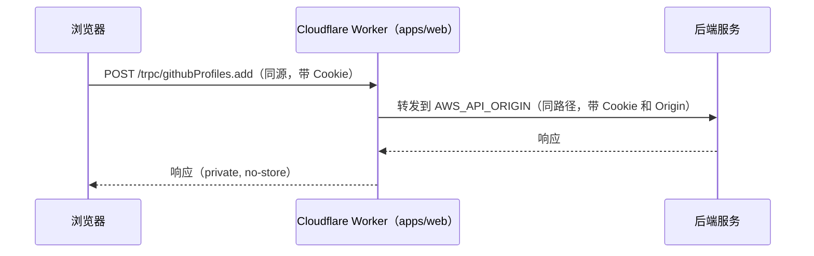

# Web 部署到 Cloudflare - 设计

> 对应需求：[requirements.md](./requirements.md)

## 概述

沿用工作区中已有的 OpenNext 配置和转发路由（尚未提交）。Web 和接口对浏览器来说是同一个域名，因此 `apps/web/src/proxy.ts` 能读到会话 Cookie，不需要跨域 Cookie。本 feature 核对配置、验证转发行为，并完成线上验收。发布和凭证输入由用户手动执行，见 `aws任务/云端部署.md`。

## 技术背景

> 依据：[AGENTS.md](../../../AGENTS.md)、[apps/web/AGENTS.md](../../../apps/web/AGENTS.md)

| 项 | 本 feature 遵循的约定 | 出处 |
|----|----------------------|------|
| 技术栈 | Next.js 16，`@opennextjs/cloudflare`、`wrangler` | apps/web/package.json |
| 环境变量 | `.env.schema` 声明，新增变量同步 `turbo.json` | AGENTS.md § 架构要点 |
| 登录拦截 | Proxy 只看 Cookie，页面内校验会话 | AGENTS.md § 经验沉淀 |
| 发布 | `opennextjs-cloudflare build` / `deploy`，通过 `--var` 注入 `AWS_API_ORIGIN` | `.github/workflows/deploy.yml` |
| 测试与验证 | 只检查改动文件的 ultracite | AGENTS.md § 经验沉淀 |

参考的现有实现：

- `apps/web/src/lib/proxy-aws-api.ts`：转发逻辑
- `.github/workflows/deploy.yml`：构建和发布步骤
- `aws任务/云端部署.md`：发布和验收步骤

## 涉及范围

| 类型 | 路径 / 模块 | 新增 / 修改 | 说明 |
|------|-------------|-------------|------|
| 配置 | `apps/web/wrangler.jsonc` | 修改 | Worker 配置（已存在，核对） |
| 配置 | `apps/web/open-next.config.ts` | 修改 | OpenNext 配置（已存在，核对） |
| 配置 | `apps/web/.env.schema` | 修改 | `AWS_API_ORIGIN`（已存在，核对） |
| 前端 | `apps/web/src/lib/proxy-aws-api.ts` | 修改 | 转发逻辑（已存在，核对） |
| 前端 | `apps/web/src/app/trpc/[...path]/route.ts` | 修改 | tRPC 转发（已存在，核对） |
| 前端 | `apps/web/src/app/api/auth/[...path]/route.ts` | 修改 | 登录转发（已存在，核对） |

## 接口设计

满足 R2、R3。

### `GET | POST /trpc/*`、`GET | POST /api/auth/*`（Web 路由）

- 转发的请求头：`accept`、`content-type`、`cookie`、`origin`
- 响应：上游状态码和响应头（含 `Set-Cookie`），删除 `content-encoding`、`content-length`，设置 `cache-control: private, no-store`
- 错误：`AWS_API_ORIGIN` 未配置时 503；上游不可达时 502

## 关键流程

满足 R2。

## 异常与边界情况

| 场景 | 处理方式 |
|------|----------|
| 后端 `CORS_ORIGIN` 或可信来源不是 Web 线上域名 | 登录失败，发布时把 Web 域名配置到后端 |
| `NEXT_PUBLIC_SERVER_URL` 为空 | tRPC 使用相对路径 `/trpc`，走同源转发 |
| 后端发生 3xx 跳转 | `redirect: "manual"`，跳转原样返回浏览器 |

## 测试策略

- 本地：`opennextjs-cloudflare build` 后用 `opennextjs-cloudflare preview` 验证 503 和 502。
- 线上：由用户发布后，按 requirements.md 的 AC2、AC3、AC4、AC7 验收。

## 待确认问题

无
