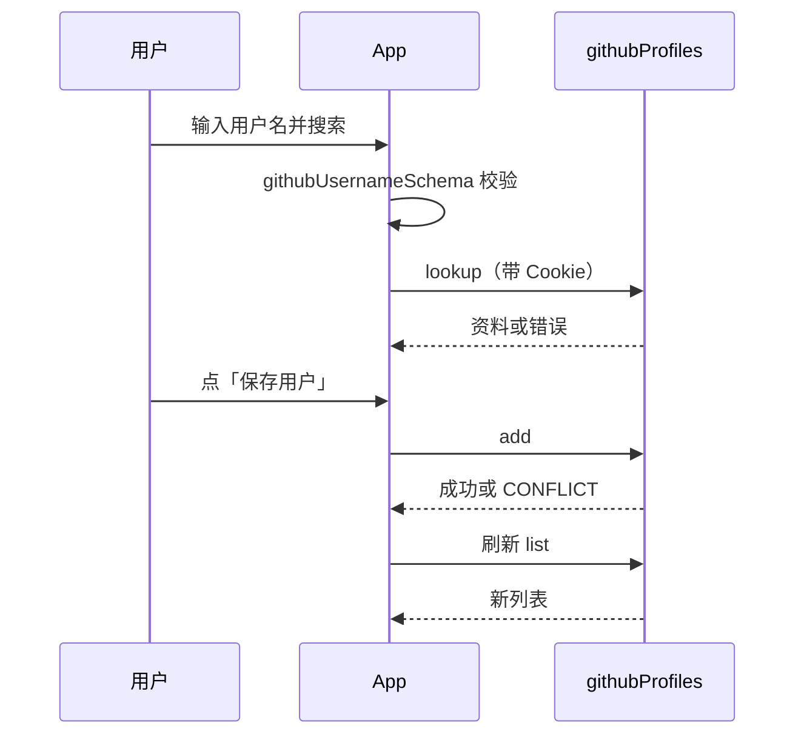

# GitHub 用户管理（移动端） - 设计

> 对应需求：[requirements.md](./requirements.md)

## 概述

在 `(drawer)` 下新增页面，直接调用 04–06 的 `githubProfiles` 接口，不新增后端代码。校验规则和字段长度从 `@sl-ai-admin/api/github-profile-rules` 导入，与 Web 使用同一份。头像用 React Native 的 `Image`，打开主页用已安装的 `expo-linking`，不引入新依赖。

## 技术背景

> 依据：[AGENTS.md](../../../AGENTS.md)

| 项 | 本 feature 遵循的约定 | 出处 |
|----|----------------------|------|
| 技术栈 | Expo Router、HeroUI Native、Uniwind、tRPC + TanStack Query | AGENTS.md § 技术栈 |
| 路由与登录保护 | 需要登录的页面放进 `(drawer)`，受根布局 `Stack.Protected` 保护 | AGENTS.md § 架构要点 |
| UI | Native 用 HeroUI Native，不共用 `packages/ui` | AGENTS.md § 架构要点 |
| 共享规则 | 规则只放一处；`workspace:*` 依赖可被 Metro 解析 | AGENTS.md § 架构要点、§ 经验沉淀 |
| 代码规范 | `useRef<InputRef \| null>(null)`；状态先算成枚举再查表，避开 Biome 误报 | AGENTS.md § 经验沉淀 |
| 测试与验证 | 没有 UI 自动化测试；`check-types` + `expo export`，Android 模拟器验收 | AGENTS.md § 常用命令 |

参考的现有实现：

- `apps/native/app/(drawer)/index.tsx`：页面、tRPC 查询、`Container`
- `apps/native/app/(drawer)/_layout.tsx`：`Drawer.Screen` 写法
- `apps/native/components/sign-in.tsx`：表单、`TextField`、`FieldError`、`Spinner`
- `apps/native/lib/form-error.ts`：表单错误文案
- `apps/web/src/app/dashboard/github-users/github-users.tsx`：同一功能的 Web 交互
- `specs/sl-ai-admin/03-native-username-auth/manual-checklist.md`：手动验收清单格式

## 涉及范围

| 类型 | 路径 / 模块 | 新增 / 修改 | 说明 |
|------|-------------|-------------|------|
| 路由 | `apps/native/app/(drawer)/_layout.tsx` | 修改 | 增加 `Drawer.Screen name="github-users"` |
| 路由 | `apps/native/app/(drawer)/github-users.tsx` | 新增 | 页面，组合搜索和列表 |
| 组件 | `apps/native/components/github-users/profile-details.tsx` | 新增 | 头像、用户名链接、资料 |
| 组件 | `apps/native/components/github-users/search-card.tsx` | 新增 | 搜索、校验、保存 |
| 组件 | `apps/native/components/github-users/saved-profiles.tsx` | 新增 | 列表、空状态、编辑和删除状态 |
| 组件 | `apps/native/components/github-users/edit-profile-form.tsx` | 新增 | 就地编辑 |
| 工具 | `apps/native/lib/trpc-error.ts` | 新增 | 把错误转成可读提示 |
| 文档 | `specs/sl-ai-admin/08-native-github-profiles/manual-checklist.md` | 新增 | Android 模拟器验收记录 |

## 接口设计

满足 R2、R4、R5、R6、R7。直接使用 04–06 定义的接口：`githubProfiles.lookup`、`add`、`list`、`update`、`remove`，通过 `apps/native/utils/trpc.ts` 自动携带会话 Cookie。

## 界面设计

满足 R1–R8。

### 移动端 · GitHub 用户管理

- 组件结构：`Container` → `SearchCard`（`TextField` + `Input` + `Button` + `ProfileDetails`）→ `SavedProfiles`（`Card` 列表，项内切换 `ProfileDetails`、`EditProfileForm`、删除确认）
- 状态：`search`、`formatError` 在 `SearchCard`；`editingId`、`deletingId` 在 `SavedProfiles`，互斥
- 查询：`useQuery(trpc.githubProfiles.lookup.queryOptions(search, { enabled: search.length > 0, retry: false }))`；`list` 同 Web
- 数据更新：mutation 成功后 `queryClient.invalidateQueries(trpc.githubProfiles.list.queryFilter())`
- 表单：`Input` 的 `maxLength` 来自 `GITHUB_PROFILE_LIMITS`，简介用 `multiline`；用户名输入 `autoCapitalize="none"`、`autoCorrect={false}`
- 打开主页：`Linking.openURL(`https://github.com/${username}`)`（`expo-linking`）
- 键盘：沿用 `Container` 的 `ScrollView` 和 `keyboardShouldPersistTaps="handled"`，复用登录页的键盘适配
- 状态显示：加载用 `Spinner` 和文案；错误用 `text-danger` 就地显示；进行中按钮 `isDisabled`
- 适配：沿用 HeroUI Native 主题 token，自动支持深色模式

## 关键流程

满足 R2、R4。

## 异常与边界情况

| 场景 | 处理方式 |
|------|----------|
| 服务器不可达（tRPC 错误没有 `data.code`） | `trpc-error.ts` 返回「操作失败，请稍后重试」 |
| 接口返回业务错误 | 显示接口的中文 `message` |
| 登录过期（401） | 显示接口提示，重新进入时由根布局按会话状态处理 |
| 系统无法打开链接 | `openURL` 的拒绝被捕获，显示「操作失败，请稍后重试」 |
| 头像为空 | 不渲染 `Image` |

## 测试策略

移动端没有 UI 自动化测试：用 `pnpm -F native check-types` 和 `expo export` 检查，再由 Claude 用 adb 操作 Android 模拟器，按 `manual-checklist.md` 逐条验收。iOS 只做 `expo export`，未验证运行效果。接口逻辑由 04–06 的单元测试覆盖。

## 待确认问题

无（App 端范围和数据归属见 requirements.md）
